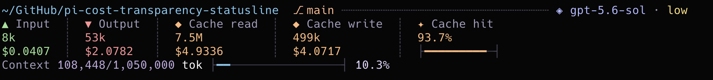

# @nilskluewer/pi-cost-transparency-statusline

A cost transparency status line for the [Pi coding agent](https://pi.dev/).



It replaces Pi's footer with a compact pastel telemetry dashboard that makes token usage and spend fully transparent:

- current working directory and Git branch
- active model and thinking level
- accumulated input/output/cache-read/cache-write tokens
- cache hit rate with a colored progress rail
- context window usage with a colored progress rail
- full cost breakdown: input, output, cache read, cache write, and total

## Install

```bash
pi install npm:@nilskluewer/pi-cost-transparency-statusline
```

## Notes

This package was previously published as `@nilskluewer/pi-statusline`.
Use this package going forward.

If you want message wrapping and the live tool side panel too, use `@nilskluewer/pi-terminal-ui` instead.

## Pilo / RPC

In RPC mode the extension publishes recorded usage as a widget and sends significant prompt-cache misses through `ctx.ui.notify(..., "warning")`. Pilo's desktop and WebUI both show these notifications; no Pilo rebuild is needed. Reload or restart an existing Pi session after updating the extension.

The warning follows Pi 1.1's cache rules: it compares consecutive requests on the active branch, accounts for cache warming, and resets after compaction or branch summaries. First requests and providers that have never reported cache activity stay quiet. Misses above 1,024 tokens are displayed when they reach 20,000 tokens or about $0.10 of estimated extra cost. The idle wording starts at five minutes; it describes an observed miss, not a guarantee that every provider expires its cache at that time.

The estimated extra cost is already included in the request's recorded usage. It is not added to the total again. These notifications are live only: reopening a session does not replay old warnings. Terminal mode keeps Pi's own notice, without a duplicate plugin warning.

Run the local usage and cache tests with:

```bash
node --experimental-strip-types --test tests/*.test.ts
```

## License

MIT
